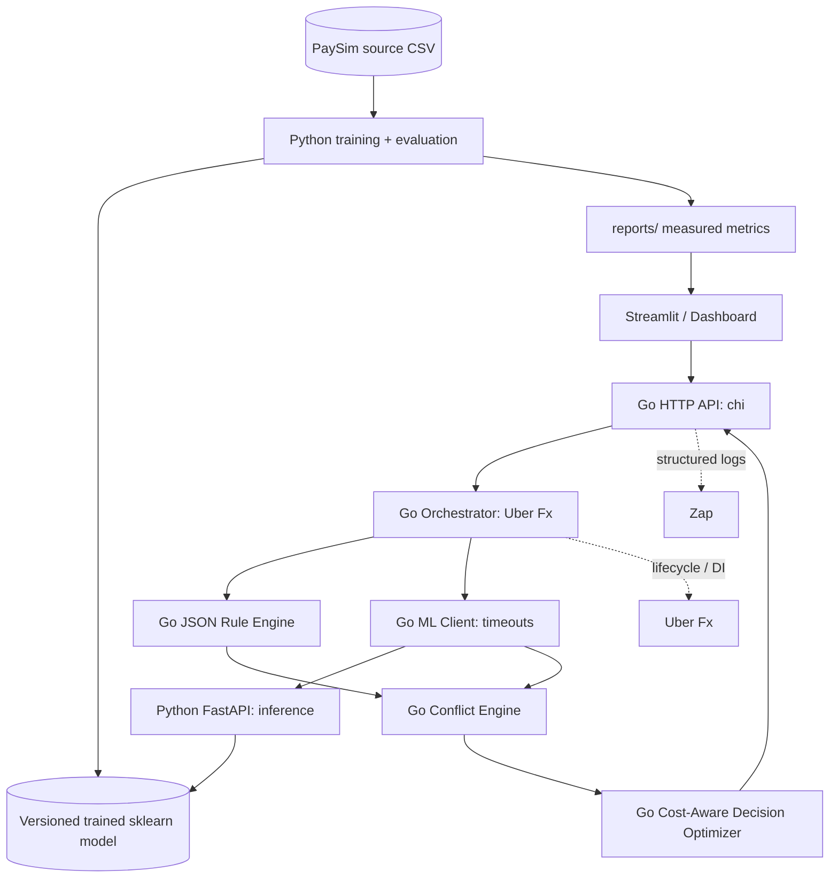

# Architecture — Go-owned Domain / Python-owned ML

## Principle
High-value AI experiments + polished demonstration; not a banking platform. One Go process and one Python inference process + optional Streamlit UI. A modular monolith, no user accounts or database.

## Layers (dependencies point inward)
1. `domain`: typed transaction, signal, decision, explainability trace, validation; no network imports.
2. `infrastructure`: config + Zap logger + HTTP server (Fx lifecycle), Python ML HTTP client.
3. `rules`: declarative JSON DSL parser, validation, deterministic AST interpreter, fired-rule metadata. Do not execute arbitrary strings.
4. `ml`: external Python trained model, feature-parity guarantee, persisted artifacts + metadata and calibration; no access to future columns.
5. `hybrid`: conflict label (`agree-low`, `agree-high`, `ml-only`, `rules-only`), configurable fusion strategy, validation-set-only tuning; never train fusion on held-out test.
6. `policy`: actionable `APPROVE`, `REVIEW`, `FLAG` with cost assumptions; batching/top-K capacity belongs to offline experiment and optional simulator, not fake real-time global state.
7. `api/presentation`: safe typed public interface and explicit explanations; UI demonstrates but does not retrain.
8. `evaluation`: independent, chronological ablations and drift analysis.

## Flow
Validate request -> call ML score with finite timeout -> run rule evaluator locally -> compute conflict -> fuse score (risk score, **not necessarily calibrated probability**) -> choose action by frozen policy -> return versioned explanation/decision. If ML missing/unavailable, return 503; no invented fallback. Pure rules-only mode may exist only as an explicitly labeled separate experiment.

## Design contracts
- Go scoring client interface: `Score(context.Context, domain.Transaction) (domain.MLSignal, error)`; injected via Fx.
- Go rule evaluator: `Evaluate(domain.Transaction) (domain.RuleSignal, error)`.
- Go fusion: `Combine(MLSignal, RuleSignal) (FusionSignal, ConflictType)`.
- Go policy: `Decide(FusionSignal, CostConfig) Decision`.
- Python service: feature transform shared between training and inference, artifact version and fixed schema.
- Rule score is a HEURISTIC; calibrate separately if you want to use it as probability. Weighting two scores does not magically give probability.

## Failure modes
- Python unavailable/timeout/bad JSON -> Go 503 and redact internals.
- Model artifact absent -> Python ready false / 503, no false-success.
- Malformed rule AST -> reject startup/config, do not run invalid rule quietly.
- Nonfinite or negative amount, unknown transaction type, invalid step -> Go 400.
- Calibration drift -> metrics report and limitation; no promise of deployment-grade calibration.
- Huge CSV -> chunking + negative subsampling only in **train**; calibration and test distribution are never resampled.

## Technology policy
- Go: Fx, Zap, chi, standard net/http (timeouts), optional OpenTelemetry only when working. Avoid introducing dependencies for appearances.
- Python: pandas, scikit-learn, joblib, FastAPI, Uvicorn; Streamlit + Plotly for dashboard.
- No GORM/Postgres/Redis unless a concrete requirement appears. Experimental results saved to JSON/CSV/PNG, artifacts with hashes.

## Bootstrap implementation notes
The working project is at the Git repository root. The redundant starter copy was removed after implementation; personal AI instructions and implementation journals are local and ignored by Git. The local Graphify graph covers code AST only; no document semantic coverage is claimed.

Python inference now uses a FastAPI lifespan and verifies both artifact checksums and feature schema before readiness. Both offline evidence and the HTTP scorer use `services.ml.inference.predict_scores`. Training remains separate and must not evaluate the final test. The full data audit may count held-out labels for provenance, but no final predictions or policy tuning are permitted until the evaluation gate.

## Go policy implementation
`policy.Config.Combine` implements the explicit strategies. Conflict-aware fusion moves the weighted score toward the larger independent signal on disagreement, by a selection-frozen disagreement weight; agreements retain the weighted score. This formulation is a hypothesis evaluated against the simple hybrid, not an assumed gain. `policy.Config.Action` maps frozen thresholds to recommendations. `policy.Scenario.Loss` owns the hypothetical true-state × action payoff table including review residual risk. No probability meaning is assigned to heuristic fusion scores. Cost thresholds are chosen empirically on selection rather than treating heuristic scores as probabilities.

The Go batch evaluator must call these same functions; Python only supplies model scores and computes analytical metrics. Classification alerts and cost-policy recommendations are different report measures and must be labeled separately.

## Frozen experiment and scenario lab
Final evaluation completed once with `reports/final-evaluation.lock`. Go batch and HTTP share rule evaluation, Config.Combine and Config.Action; parity passed on nine synthetic selection-window samples. Offline ApplyCapacity may downgrade REVIEW to APPROVE; online recommendations intentionally have no global queue.

`transport/simulation.go` accepts aggregate frozen actions for hypothetical re-costing with policy.Scenario.Loss. Streamlit sends counts and assumptions to Go; it never calculates policy costs or trains a model. Scenario-only figures are separate from immutable reported final-test findings.
